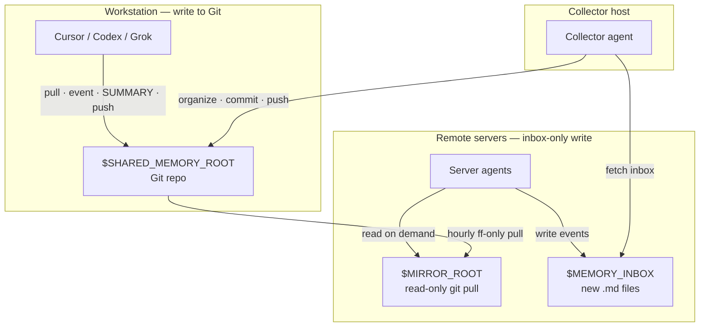

# Shared Memory for Agents

**English** · [中文](README.zh.md)

A lightweight, Git-backed shared memory template so Cursor, Codex, Grok Bot, and other agents can read and write durable conclusions across workstations and remote servers—without stuffing secrets into the repo.

> License: **MIT** · Status: template / starter · Demo: `demo/hello-memory` (format) · `demo/acme-cli` (worked memory effect)

---

## This is a TEMPLATE

This repository ships **placeholders only**. The human’s job is mainly to **clone**, then **instruct each agent** (profile / system prompt / Cursor rule / chat) to finish the wiring. Tell your agents to:

1. Follow **[AGENTS.md](AGENTS.md)** (plus **[SERVER.md](SERVER.md)** on remote hosts, **[COLLECTOR.md](COLLECTOR.md)** on the collector).
2. Install `skills/shared-memory-manager`.
3. **Copy `config.example.env` → `config.env` (gitignored) and complete** real paths, inbox locations, and SSH **Host** aliases — the names `server-a` / `server-b` / `server-workstation` / `jump-a` are examples, not real hosts. Agents should ask you only for facts they cannot discover (e.g. which Host alias maps to which machine).

Do **not** treat filling `config.env` as a manual checklist for the human as the primary step — **tell your agent to complete configuration**.

---

## Why

Agents on different machines forget each other. This template gives them:

| Role | What they do |
|------|----------------|
| **Workstation writers** | Commit events + SUMMARY into the Git repo |
| **Server agents** | Write only to a local **inbox**; read a **read-only mirror** |
| **Collector** | Pull inboxes, denoise, archive, push; optional weekly digest |

---

## Architecture



Text view:

```
workstation  ──git push──►  GitHub / remote
     ▲                           │
     │                           │ hourly pull --ff-only
collector ◄──ssh inbox──  server-* / server-workstation
     │                     ($MEMORY_INBOX + $MIRROR_ROOT)
     └──organize & push──► remote
```

---

## Quick start

1. **Clone** this template into your own private (or public) memory repo.
2. **Point your agents** at this repo and the skill: tell each agent (profile / system prompt / Cursor rule / chat) to follow **[AGENTS.md](AGENTS.md)** and install `skills/shared-memory-manager`. On servers, also point them at **[SERVER.md](SERVER.md)** (and optionally `.cursor/rules/shared-memory.mdc`). On the collector host, point them at **[COLLECTOR.md](COLLECTOR.md)**.
3. **Ask your agent** to create `config.env` from `config.example.env` and complete the placeholders for your machines (`SHARED_MEMORY_ROOT`, `MEMORY_INBOX_*` / `MIRROR_ROOT_*`, `SSH_HOST_*` — SSH Host aliases from `~/.ssh/config`, never raw IPs in docs). Supply only the facts the agent cannot discover.
4. **Ask the collector agent** to run the first collect once `config.env` is ready.
5. **Try the demos**: `demo/hello-memory/` (minimal file shape) and `demo/acme-cli/` (matured project memory).

Do **not** put this repo inside a working project tree (agents may auto-load it as project context).

---

## Memory effect

Without shared memory, each new agent re-discovers the same pitfalls and paths. With this skill + collector, durable conclusions land in each project's `SUMMARY.md`. Saying 「读共享记忆」 on a *new* agent loads `MEMORY.md` → relevant `SUMMARY.md` → only then `events/` — so they inherit decisions, key paths, and pitfalls instead of starting from zero. See **`demo/acme-cli/`** for what a matured project memory looks like after a few days of cross-host use; **`demo/hello-memory/`** is only the minimal file shape.

---

## Repository layout

```
.
├── README.md              # English
├── README.zh.md           # Chinese
├── AGENTS.md              # Universal read/write rules
├── SERVER.md              # Server agents: inbox write + read-only mirror
├── COLLECTOR.md           # Collect · denoise · weekly digest
├── MEMORY.md              # Index (demo only in this template)
├── DESENSITIZE.md         # Contributor checklist — keep secrets out
├── config.example.env     # Env var placeholders
├── LICENSE                # MIT
├── demo/hello-memory/     # Minimal fictional format sample
├── demo/acme-cli/         # Richer fictional "after using the skill" showcase
├── _inbox/                # Pending domain items (workstation)
├── _facts/                # Stable cross-project facts
├── memory_inbox/          # Template README for server inboxes
├── .cursor/rules/         # Short pointer rule
├── skills/                # Agent skill (Cursor / Grok)
└── scripts/collect.example.sh
```

---

## Security

- **Never store** tokens, passwords, API keys, private keys, session cookies, or raw credentials in memory files.
- Paths may be recorded as *locations of artifacts*; secrets stay in password managers / env / secret stores.
- Before publishing or opening a PR, run the checks in **[DESENSITIZE.md](DESENSITIZE.md)**.
- This OSS template uses only placeholders (`YOUR_GITHUB_USER`, `workstation`, `server-a`, `$SHARED_MEMORY_ROOT`, …). When instructed, **agents** replace them in local `config.env`; do not commit real hostnames, IPs, or account names to public forks.

---

## Docs map

| File | Audience |
|------|----------|
| [README.md](README.md) / [README.zh.md](README.zh.md) | Humans & agents — English / Chinese overview |
| [AGENTS.md](AGENTS.md) | Every agent that reads or writes memory |
| [SERVER.md](SERVER.md) | Server agents on remote hosts |
| [COLLECTOR.md](COLLECTOR.md) | The collector agent on the workstation |
| [DESENSITIZE.md](DESENSITIZE.md) | Humans contributing to public copies |
| [skills/shared-memory-manager/SKILL.md](skills/shared-memory-manager/SKILL.md) | Skill entry for Cursor / Grok |

---

## License

[MIT](LICENSE) © YOUR_GITHUB_USER / contributors
