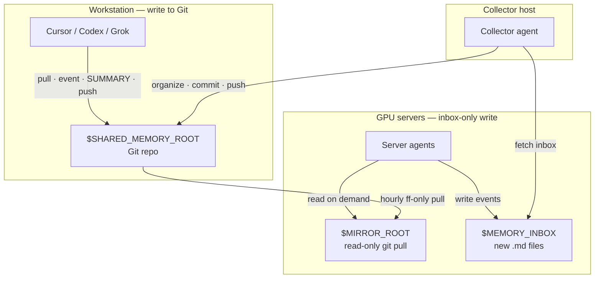

# Shared Memory for Agents / 跨端跨工具共享记忆

**English** · A lightweight, Git-backed shared memory template so Cursor, Codex, Grok Bot, and other agents can read and write durable conclusions across workstations and GPU servers—without stuffing secrets into the repo.

**中文** · 一套基于 Git 的轻量共享记忆开源模板：让 Cursor / Codex / Grok Bot 等 agent 在工作站与 GPU 服务器之间共享「结论、决定、踩坑、关键路径」，且**永不把密钥写进仓库**。

> License: **MIT** · Status: template / starter · Demo project: `demo/hello-memory`

---

## Why / 为什么需要

Agents on different machines forget each other. This template gives them:

| Role | What they do |
|------|----------------|
| **Workstation writers** | Commit events + SUMMARY into the Git repo |
| **Server agents** | Write only to a local **inbox**; read a **read-only mirror** |
| **Collector** | Pull inboxes, denoise, archive, push; optional weekly digest |

---

## Architecture / 架构



Text view:

```
workstation  ──git push──►  GitHub / remote
     ▲                           │
     │                           │ hourly pull --ff-only
collector ◄──ssh inbox──  gpu-cluster-* / gpu-workstation
     │                     ($MEMORY_INBOX + $MIRROR_ROOT)
     └──organize & push──► remote
```

---

## Quick start / 快速开始

1. **Clone this template** into your own private (or public) memory repo.
2. Copy `config.example.env` → `config.env` (gitignored). Fill placeholders:
   - `SHARED_MEMORY_ROOT` — path to the Git checkout on the workstation
   - `MEMORY_INBOX_*` / `MIRROR_ROOT_*` — per-host inbox & mirror paths
   - `SSH_HOST_*` — SSH Host aliases from `~/.ssh/config` (never raw IPs in docs)
3. Read **[AGENTS.md](AGENTS.md)** (all writers), **[SERVER.md](SERVER.md)** (GPU agents), **[COLLECTOR.md](COLLECTOR.md)** (collector).
4. Optionally install the skill: copy `skills/shared-memory-manager/` into your agent skills dir.
5. On servers, point Cursor rules at the mirror: see `.cursor/rules/shared-memory.mdc`.
6. Try the demo: open `demo/hello-memory/SUMMARY.md` and the sample event.

Do **not** put this repo inside a working project tree (agents may auto-load it as project context).

---

## Repository layout / 目录

```
.
├── AGENTS.md              # Universal read/write rules
├── SERVER.md              # Server: inbox write + read-only mirror
├── COLLECTOR.md           # Collect · denoise · weekly digest
├── MEMORY.md              # Index (demo only in this template)
├── DESENSITIZE.md         # Contributor checklist — keep secrets out
├── config.example.env     # Env var placeholders
├── LICENSE                # MIT
├── demo/hello-memory/     # Fictional harmless example
├── _inbox/                # Pending domain items (workstation)
├── _facts/                # Stable cross-project facts
├── memory_inbox/          # Template README for server inboxes
├── .cursor/rules/         # Short pointer rule
├── skills/                # Agent skill (Cursor / Grok)
└── scripts/collect.example.sh
```

---

## Security / 安全声明

- **Never store** tokens, passwords, API keys, private keys, session cookies, or raw credentials in memory files.
- Paths may be recorded as *locations of artifacts*; secrets stay in password managers / env / secret stores.
- Before publishing or opening a PR, run the checks in **[DESENSITIZE.md](DESENSITIZE.md)**.
- This OSS template uses only placeholders (`YOUR_GITHUB_USER`, `workstation`, `gpu-cluster-a`, `$SHARED_MEMORY_ROOT`, …). Replace them locally; do not commit real hostnames, IPs, or account names to public forks.

---

## Docs map / 文档地图

| File | Audience |
|------|----------|
| [AGENTS.md](AGENTS.md) | Every agent that reads or writes memory |
| [SERVER.md](SERVER.md) | Agents running on GPU / remote hosts |
| [COLLECTOR.md](COLLECTOR.md) | The collector agent on the workstation |
| [DESENSITIZE.md](DESENSITIZE.md) | Humans contributing to public copies |
| [skills/shared-memory-manager/SKILL.md](skills/shared-memory-manager/SKILL.md) | Skill entry for Cursor / Grok |

---

## License

[MIT](LICENSE) © YOUR_GITHUB_USER / contributors
