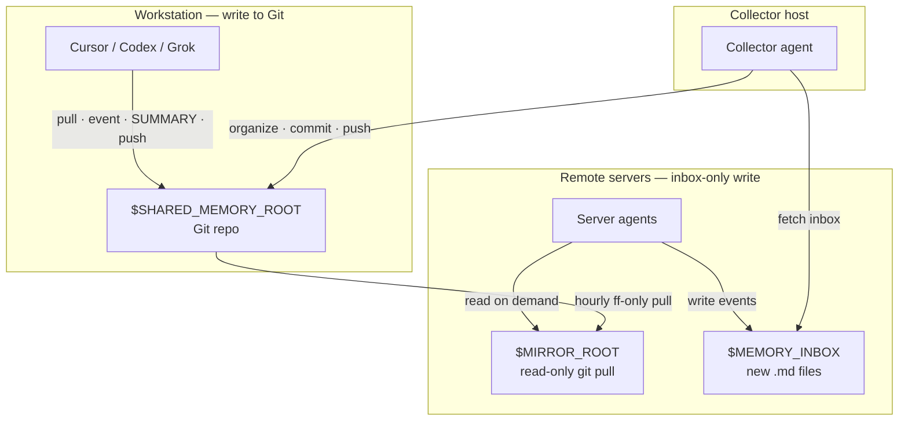

# Shared Memory for Agents / 跨端跨工具共享记忆

**English** · A lightweight, Git-backed shared memory template so Cursor, Codex, Grok Bot, and other agents can read and write durable conclusions across workstations and remote servers—without stuffing secrets into the repo.

**中文** · 一套基于 Git 的轻量共享记忆开源模板：让 Cursor / Codex / Grok Bot 等 agent 在工作站与远程服务器之间共享「结论、决定、踩坑、关键路径」，且**永不把密钥写进仓库**。

> License: **MIT** · Status: template / starter · Demo: `demo/hello-memory` (format) · `demo/acme-cli` (worked memory effect)

---

## This is a TEMPLATE / 这是一份模板

**English** · This repository ships **placeholders only**. Before it is useful you must:

1. Tell **each of your agents** (profile / system prompt / Cursor rule) to follow **[AGENTS.md](AGENTS.md)** (plus **[SERVER.md](SERVER.md)** on remote hosts, **[COLLECTOR.md](COLLECTOR.md)** on the collector) and to install `skills/shared-memory-manager`.
2. Copy `config.example.env` → `config.env` (gitignored) and fill **your** paths, inbox locations, and SSH **Host** aliases — the names `server-a` / `server-b` / `server-workstation` / `jump-a` are examples, not real hosts.

**中文** · 本仓库只提供占位符。真正可用前你必须：

1. 让**每一个**自己的 agent（profile / system prompt / Cursor rule）遵守 **[AGENTS.md](AGENTS.md)**（远程主机再读 **[SERVER.md](SERVER.md)**，收取端再读 **[COLLECTOR.md](COLLECTOR.md)**），并安装 `skills/shared-memory-manager`。
2. 复制 `config.example.env` → `config.env`（已 gitignore），填入**你自己的**路径、收件箱与 SSH Host 别名——`server-a` / `server-b` / `server-workstation` / `jump-a` 只是示例，不是真实主机。

---

## Why / 为什么需要

Agents on different machines forget each other. This template gives them:

| Role | What they do |
|------|----------------|
| **Workstation writers** | Commit events + SUMMARY into the Git repo |
| **Server agents** | Write only to a local **inbox**; read a **read-only mirror** |
| **Collector** | Pull inboxes, denoise, archive, push; optional weekly digest |

---

## Architecture / 架构



Text view:

```
workstation  ──git push──►  GitHub / remote
     ▲                           │
     │                           │ hourly pull --ff-only
collector ◄──ssh inbox──  server-* / server-workstation
     │                     ($MEMORY_INBOX + $MIRROR_ROOT)
     └──organize & push──► remote
```

---

## Quick start / 快速开始

1. **Clone this template** into your own private (or public) memory repo.
2. Copy `config.example.env` → `config.env` (gitignored). Fill placeholders:
   - `SHARED_MEMORY_ROOT` — path to the Git checkout on the workstation
   - `MEMORY_INBOX_*` / `MIRROR_ROOT_*` — per-host inbox & mirror paths
   - `SSH_HOST_*` — SSH Host aliases from `~/.ssh/config` (never raw IPs in docs)
3. Read **[AGENTS.md](AGENTS.md)** (all writers), **[SERVER.md](SERVER.md)** (server agents), **[COLLECTOR.md](COLLECTOR.md)** (collector).
4. **Tell each of your agents** (profile / system prompt / Cursor rule) to follow AGENTS.md + install `skills/shared-memory-manager`; fill `config.env` before the first collect.
5. Optionally install the skill: copy `skills/shared-memory-manager/` into your agent skills dir.
6. On servers, point Cursor rules at the mirror: see `.cursor/rules/shared-memory.mdc`.
7. Try the demos: `demo/hello-memory/` (minimal file shape) and `demo/acme-cli/` (matured project memory).

Do **not** put this repo inside a working project tree (agents may auto-load it as project context).

---

## Memory effect / 使用后的记忆效果

**English** · Without shared memory, each new agent re-discovers the same pitfalls and paths. With this skill + collector, durable conclusions land in each project's `SUMMARY.md`. Saying 「读共享记忆」 on a *new* agent loads `MEMORY.md` → relevant `SUMMARY.md` → only then `events/` — so they inherit decisions, key paths, and pitfalls instead of starting from zero. See **`demo/acme-cli/`** for what a matured project memory looks like after a few days of cross-host use; **`demo/hello-memory/`** is only the minimal file shape.

**中文** · 没有共享记忆时，每个新 agent 都会重新踩同一批坑、重新找同一批路径。启用本 skill + collector 后，持久结论会落入各项目的 `SUMMARY.md`。在新 agent 上说「读共享记忆」时，按 `MEMORY.md` → 相关 `SUMMARY.md` → 必要时才开 `events/` 的顺序加载，从而继承已有决定、关键路径与踩坑记录。具体长什么样见 **`demo/acme-cli/`**（跨工作站 + 服务器用了几天后的样子）；**`demo/hello-memory/`** 只演示最小文件形态。

---

## Repository layout / 目录

```
.
├── AGENTS.md              # Universal read/write rules
├── SERVER.md              # Server agents: inbox write + read-only mirror
├── COLLECTOR.md           # Collect · denoise · weekly digest
├── MEMORY.md              # Index (demo only in this template)
├── DESENSITIZE.md         # Contributor checklist — keep secrets out
├── config.example.env     # Env var placeholders
├── LICENSE                # MIT
├── demo/hello-memory/     # Minimal fictional format sample
├── demo/acme-cli/         # Richer fictional "after using the skill" showcase
├── _inbox/                # Pending domain items (workstation)
├── _facts/                # Stable cross-project facts
├── memory_inbox/          # Template README for server inboxes
├── .cursor/rules/         # Short pointer rule
├── skills/                # Agent skill (Cursor / Grok)
└── scripts/collect.example.sh
```

---

## Security / 安全声明

- **Never store** tokens, passwords, API keys, private keys, session cookies, or raw credentials in memory files.
- Paths may be recorded as *locations of artifacts*; secrets stay in password managers / env / secret stores.
- Before publishing or opening a PR, run the checks in **[DESENSITIZE.md](DESENSITIZE.md)**.
- This OSS template uses only placeholders (`YOUR_GITHUB_USER`, `workstation`, `server-a`, `$SHARED_MEMORY_ROOT`, …). Replace them locally; do not commit real hostnames, IPs, or account names to public forks.

---

## Docs map / 文档地图

| File | Audience |
|------|----------|
| [AGENTS.md](AGENTS.md) | Every agent that reads or writes memory |
| [SERVER.md](SERVER.md) | Server agents on remote hosts |
| [COLLECTOR.md](COLLECTOR.md) | The collector agent on the workstation |
| [DESENSITIZE.md](DESENSITIZE.md) | Humans contributing to public copies |
| [skills/shared-memory-manager/SKILL.md](skills/shared-memory-manager/SKILL.md) | Skill entry for Cursor / Grok |

---

## License

[MIT](LICENSE) © YOUR_GITHUB_USER / contributors
