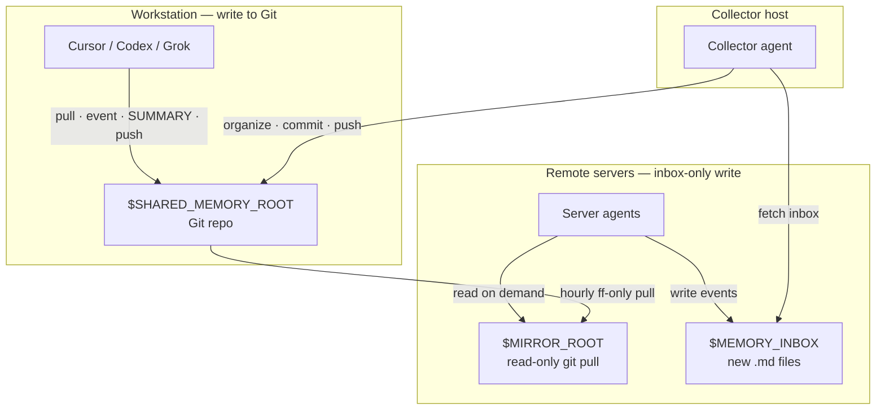

# 跨端跨工具共享记忆

[English](README.md) · **中文**

一套基于 Git 的轻量共享记忆开源模板：让 Cursor / Codex / Grok Bot 等 agent 在工作站与远程服务器之间共享「结论、决定、踩坑、关键路径」，且**永不把密钥写进仓库**。

> 许可：**MIT** · 状态：模板 / 起步仓库 · 演示：`demo/hello-memory`（文件形态）· `demo/acme-cli`（用过后的记忆效果）

---

## 这是一份模板

本仓库只提供**占位符**。人的主要工作是：**克隆**，然后**指示各个 agent**（profile / system prompt / Cursor rule / 对话）完成接线。请让你的 agent：

1. 遵守 **[AGENTS.md](AGENTS.md)**（远程主机再读 **[SERVER.md](SERVER.md)**，收取端再读 **[COLLECTOR.md](COLLECTOR.md)**）。
2. 安装 `skills/shared-memory-manager`。
3. **把 `config.example.env` 复制为 `config.env`（已 gitignore）并填完**真实路径、收件箱与 SSH **Host** 别名——`server-a` / `server-b` / `server-workstation` / `jump-a` 只是示例，不是真实主机。agent 只需向人询问自己无法发现的事实（例如哪个 Host 别名对应哪台机器）。

**不要**把「你自己去填 `config.env`」当作主步骤——请**告诉你的 agent 完成配置**。

---

## 为什么需要

不同机器上的 agent 互不记得对方做过什么。本模板提供：

| 角色 | 做什么 |
|------|--------|
| **工作站写入端** | 把 event + SUMMARY 提交进 Git 仓库 |
| **服务器 agent** | 只写本地**收件箱**；读**只读镜像** |
| **收取端（collector）** | 拉取收件箱、降噪、归档、推送；可选周报 |

---

## 架构



文字示意：

```
workstation  ──git push──►  GitHub / remote
     ▲                           │
     │                           │ hourly pull --ff-only
collector ◄──ssh inbox──  server-* / server-workstation
     │                     ($MEMORY_INBOX + $MIRROR_ROOT)
     └──organize & push──► remote
```

---

## 快速开始

1. **克隆**本模板到你自己的（私有或公开）记忆仓库。
2. **把 agent 指向本仓库与 skill**：告诉每个 agent（profile / system prompt / Cursor rule / 对话）遵守 **[AGENTS.md](AGENTS.md)** 并安装 `skills/shared-memory-manager`。在服务器上再指向 **[SERVER.md](SERVER.md)**（可选 `.cursor/rules/shared-memory.mdc`）。在收取端主机指向 **[COLLECTOR.md](COLLECTOR.md)**。
3. **让你的 agent** 从 `config.example.env` 创建 `config.env`，并按你的机器补全占位符（`SHARED_MEMORY_ROOT`、`MEMORY_INBOX_*` / `MIRROR_ROOT_*`、`SSH_HOST_*`——来自 `~/.ssh/config` 的 Host 别名，文档中不要写真实 IP）。只提供 agent 无法自行发现的事实。
4. **`config.env` 就绪后，让 collector agent 做一次首次收取**。
5. **试用演示**：`demo/hello-memory/`（最小文件形态）与 `demo/acme-cli/`（成熟项目记忆样例）。

**不要**把本仓库放进某个业务项目目录树里（agent 可能把它当项目上下文自动加载）。

---

## 使用后的记忆效果

没有共享记忆时，每个新 agent 都会重新踩同一批坑、重新找同一批路径。启用本 skill + collector 后，持久结论会落入各项目的 `SUMMARY.md`。在新 agent 上说「读共享记忆」时，按 `MEMORY.md` → 相关 `SUMMARY.md` → 必要时才开 `events/` 的顺序加载，从而继承已有决定、关键路径与踩坑记录。具体长什么样见 **`demo/acme-cli/`**（跨工作站 + 服务器用了几天后的样子）；**`demo/hello-memory/`** 只演示最小文件形态。

---

## 目录

```
.
├── README.md              # 英文
├── README.zh.md           # 中文
├── AGENTS.md              # 通用读写规则
├── SERVER.md              # 服务器 agent：收件箱写入 + 只读镜像
├── COLLECTOR.md           # 收取 · 降噪 · 周报
├── MEMORY.md              # 索引（本模板仅为演示）
├── DESENSITIZE.md         # 贡献者清单 — 勿把密钥带进仓库
├── config.example.env     # 环境变量占位符
├── LICENSE                # MIT
├── demo/hello-memory/     # 最小虚构格式样例
├── demo/acme-cli/         # 更完整的「用过 skill 之后」虚构样例
├── _inbox/                # 待定领域条目（工作站）
├── _facts/                # 跨项目稳定事实
├── memory_inbox/          # 服务器收件箱模板 README
├── .cursor/rules/         # 短指针规则
├── skills/                # Agent skill（Cursor / Grok）
└── scripts/collect.example.sh
```

---

## 安全声明

- **永远不要**在记忆文件里存放 token、密码、API key、私钥、session cookie 或其它原始凭据。
- 路径可以记成「产物所在位置」；密钥留在密码管理器 / 环境变量 / 密钥库。
- 公开发布或开 PR 前，按 **[DESENSITIZE.md](DESENSITIZE.md)** 自查。
- 本开源模板只用占位符（`YOUR_GITHUB_USER`、`workstation`、`server-a`、`$SHARED_MEMORY_ROOT` 等）。在指示下，由 **agent** 在本地 `config.env` 中替换；不要把真实主机名、IP 或账号提交到公开 fork。

---

## 文档地图

| 文件 | 读者 |
|------|------|
| [README.md](README.md) / [README.zh.md](README.zh.md) | 人与 agent — 英文 / 中文总览 |
| [AGENTS.md](AGENTS.md) | 所有读写记忆的 agent |
| [SERVER.md](SERVER.md) | 远程主机上的 server agent |
| [COLLECTOR.md](COLLECTOR.md) | 工作站上的 collector agent |
| [DESENSITIZE.md](DESENSITIZE.md) | 向公开副本贡献的人 |
| [skills/shared-memory-manager/SKILL.md](skills/shared-memory-manager/SKILL.md) | Cursor / Grok 的 skill 入口 |

---

## 许可

[MIT](LICENSE) © dreaming-huang / contributors
